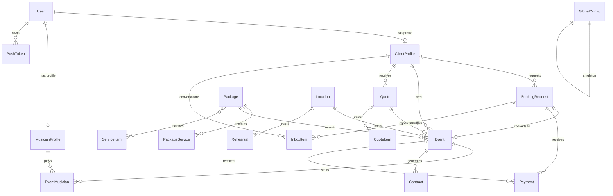
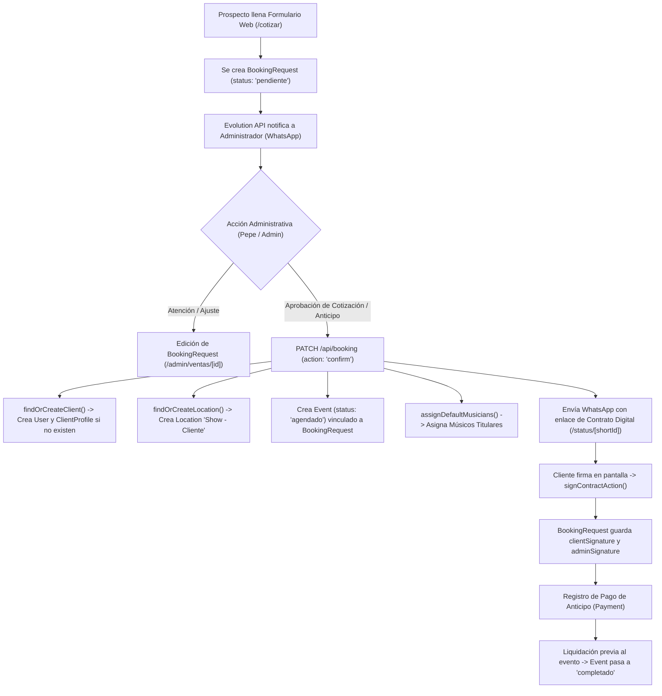

# AUDITORÍA INTEGRAL DE FLUJO DE DATOS COMERCIAL Y FORMULARIOS
**Sistema:** Vendetta Live Music (`vendetta.mx`)  
**Perfil:** Arquitectura Senior de Software (Next.js 16, TypeScript, Prisma, SQLite/LibSQL)  
**Fecha:** 21 de Agosto de 2026  
**Carácter:** Auditoría Técnica de Solo Lectura (Sin modificaciones en esquema ni producción)

---

## 1. RESUMEN EJECUTIVO

Vendetta Live Music opera sobre una arquitectura comercial centrada en el modelo **`BookingRequest`** como columna vertebral operativa y financiera. Aunque originalmente el esquema contemplaba un flujo tradicional `Quote` → `Event` → `Contract`, la evolución del código consolidó `BookingRequest` como la entidad universal que almacena simultáneamente:
1. La solicitud web (prospecto/lead).
2. La cotización paramétrica y cálculo de viáticos.
3. Los datos de contacto del cliente y ubicación del evento.
4. Las especificaciones técnicas de audio, iluminación, banda y DJ.
5. El estado financiero (monto base, anticipo, método de pago, facturación).
6. El contrato digital firmado por ambas partes (`clientSignature`, `adminSignature`).

### Hallazgos Críticos Principales:
* **Entidad Central Unificada:** No se requiere una tabla `Lead` ni un CRM paralelo. El modelo `BookingRequest` ya cuenta con `shortId` (folio amigable `VND-XXXX`), estados (`pendiente`, `agendado`, `cancelado`, `completado`), fuente (`web`, `manual`), y soporta clientes sin cuenta de usuario (`clientId` nullable).
* **Creación Tardía (Just-in-Time) de Entidades Secundarias:** Las entidades `User`, `ClientProfile`, `Location` y `Event` no se crean cuando el usuario cotiza en la web, sino únicamente cuando el administrador confirma la fecha o aprueba el anticipo (`PATCH /api/booking` o `updateBookingStatusAction`).
* **Formulario `/contacto` Huérfano:** La ruta `/contacto` contiene un formulario HTML estático sin `action`, `onSubmit` ni conexión a servidor. Todo el tráfico que intenta contactar por esa vía se pierde silenciosamente.
* **Duplicación de Ubicaciones (`Location`):** Cada confirmación genera un registro nuevo en `Location` con el patrón `Show - [Cliente] ([shortId])`, transformando la tabla de recintos en un histórico de eventos privados en lugar de un catálogo reutilizable de venues.
* **Compatibilidad Total para Formulario WhatsApp:** Es 100% factible implementar un formulario de contacto rápido hacia WhatsApp utilizando exclusivamente la tabla `BookingRequest` con `status: 'pendiente'`, generando de inmediato el `shortId`, registrando la conversación entrante en `InboxItem` / `Notification` y permitiendo la atención humana directa de Pepe sin alterar la base de datos.

---

## 2. ARQUITECTURA ENCONTRADA

### 2.1 Stack Tecnológico
* **Framework:** Next.js 16 (App Router con Server Actions y Route Handlers).
* **Lenguaje:** TypeScript 5+ (Strict mode).
* **ORM:** Prisma v7 con `@prisma/adapter-libsql` (Driver SQLite / LibSQL).
* **Capa de Base de Datos:** Base de datos relacional embebida/archivo (`/app/prisma/prod.db` en contenedor de producción).
* **Autenticación:** Auth.js v5 (NextAuth v5 Beta) con JWT y proveedor Credentials.
* **Mensajería & WhatsApp:** Evolution API v2 conectado mediante Route Handler (`/api/webhooks/evolution`) y cliente HTTP (`src/lib/notifications/whatsapp.ts`).
* **Pagos:** Stripe (actualmente deshabilitado en webhooks/checkout) y Transferencia SPEI / Efectivo (gestionado manualmente por confirmación de anticipo).
* **Documentación PDF:** `pdf-lib` + `@pdf-lib/fontkit` para generación dinámica de contratos y cotizaciones.

### 2.2 Patrón de Persistencia y "Self-Healing"
En `src/lib/db.ts`, el sistema implementa una función en runtime denominada `ensureSchemaUpToDate(prisma)` que ejecuta `PRAGMA table_info` y sentencias `ALTER TABLE ADD COLUMN` automáticas al iniciar el servidor para garantizar que columnas añadidas posteriormente (como `distanceKm`, `tollCost`, `customName`, `clientSignature`, etc.) existan en la base física SQLite sin requerir migraciones destructivas.

---

## 3. ESQUEMA REAL DE BASE DE DATOS

A continuación se detalla la estructura observable en `prisma/schema.prisma` y verificada en el runtime de `src/lib/db.ts`:

### 3.1 Tabla: `BookingRequest` (Tabla física: `BookingRequest`)
* **Propósito:** Entidad central de prospección, cotización, contratación y seguimiento comercial.
* **Clave Primaria:** `id` (String UUID).
* **Campos Principales:**
  * `shortId` (String?, Unique): Folio amigable tipo `VND-AB12`.
  * `packageId` (String?, Nullable): Relación conceptual con `Package`.
  * `packageName` (String, Obligatorio): Nombre descriptivo del paquete.
  * `guestCount` (Int, Default 0): Número de invitados.
  * `venueType` (String, Obligatorio): Tipo de recinto (`salon`, `jardin`, `hacienda`, `playa`, `casa`, `terraza`).
  * `calle`, `numero`, `colonia`, `zipCode`, `municipio`, `address`, `city`, `state`: Desglose geográfico.
  * `mapsLink` (String?, Nullable): URL de Google Maps.
  * `isOutsideZone` (Boolean, Default false): Bandera de fuera de zona local.
  * `viaticosAmount` (Float, Default 0): Monto total de viáticos calculados.
  * `distanceKm`, `durationSec`, `tollCost`, `fuelCost` (Float/Int?, Nullables): Desglose técnico de viáticos vía Google Maps.
  * `requiresManualQuote` (Boolean, Default false): Requiere revisión humana por distancia excesiva.
  * `requestedDate` (DateTime, Obligatorio): Fecha del evento.
  * `startTime`, `endTime` (String, Obligatorios): Horarios de presentación.
  * `baseAmount`, `depositAmount` (Float, Obligatorios): Monto total del show y anticipo sugerido/pactado.
  * `discountAmount`, `originalPrice` (Float?, Default 0): Gestión de promociones.
  * `paymentMethod` (String, Obligatorio): `transfer`, `cash`, `stripe`, `mercadopago`.
  * `paymentStatus` (String, Default 'pending'): `pending`, `partial`, `paid`.
  * `paymentRef` (String?, Nullable): Referencia de transferencia o transacción.
  * `clientName`, `clientPhone` (String, Obligatorios): Datos de contacto del cliente.
  * `clientEmail`, `clientUserId` (String?, Nullables): Correo y referencia de usuario.
  * `clientId` (String?, Nullable): FK a `ClientProfile.id`.
  * `eventId` (String?, Unique, Nullable): FK a `Event.id`.
  * `status` (String, Default 'pendiente'): `pendiente`, `agendado`, `cancelado`, `completado`.
  * `adminNote`, `musicianNotes` (String?, Nullables): Bitácora interna.
  * `isPublic`, `clientProvidesAudio`, `invoice` (Boolean, Defaults false): Flags operativas.
  * `bandHours`, `djHours`, `isDjWithTvs`, `hasTemplete`, `hasPista`, `hasRobot`, `hasPantalla` (Int/Boolean): Opcionales de producción.
  * `adminSignature`, `clientSignature` (String?, Nullables): Firmas en Base64.
  * `signedAt` (DateTime?, Nullable), `signedIp` (String?, Nullable): Auditoría de firma.
  * `source` (String, Default 'web'): `web`, `manual`, `whatsapp`.
  * `createdAt`, `updatedAt` (DateTime).
* **Relaciones:** `event` (`Event?`), `client` (`ClientProfile?`), `payments` (`Payment[]`), `inboxItems` (`InboxItem[]`).

### 3.2 Tabla: `User` (Tabla física: `User`)
* **Propósito:** Cuentas de acceso al sistema para Administradores, Agentes, Clientes y Músicos.
* **PK:** `id` (String UUID).
* **Campos:** `name`, `email` (Unique, Nullable), `password` (Hash), `role` (`ADMIN`, `AGENTE`, `CLIENT`, `USER`), `image`, `createdAt`, `updatedAt`.
* **Relaciones:** `clientProfile` (`ClientProfile?`), `musicianProfile` (`MusicianProfile?`), `pushTokens` (`PushToken[]`).

### 3.3 Tabla: `ClientProfile` (Tabla física: `ClientProfile`)
* **Propósito:** Perfil detallado de clientes recurrentes, empresas y datos fiscales.
* **PK:** `id` (String UUID).
* **Campos:** `userId` (String Unique, FK a `User`), `type` (`social`, `corporate`, `private`), `company`, `rfc`, `fiscalAddress`, `legalRepName`, `legalRepRole`, `legalRepPower`, `notificationAddress`, `billingData`, `notes`, `city`, `state`, `whatsapp`, `createdAt`, `updatedAt`.
* **Relaciones:** `user` (`User`), `bookings` (`BookingRequest[]`), `events` (`Event[]`), `quotes` (`Quote[]`), `inboxItems` (`InboxItem[]`).

### 3.4 Tabla: `Event` (Tabla física: `Event`)
* **Propósito:** Evento confirmado en agenda, asignación de músicos, tiempos de montaje y liquidación.
* **PK:** `id` (String UUID).
* **Campos:** `date` (DateTime), `startTime`, `performanceStart`, `performanceEnd`, `arrivalTime`, `setupTime`, `amount`, `deposit`, `balance`, `ivaAmount`, `totalIncome`, `status` (`agendado`, `cancelado`, `completado`), `guestCount`, `venueType`, `dressCode`, `musicianNotes`, `bitacora`, `audioEngineer`, `mapsLink`, `isPublic`, `clientProvidesAudio`, `invoice`, `source`, `googleCalendarId`, `locationId` (FK `Location`), `clientId` (FK `ClientProfile`), `packageId` (FK `Package`), `quoteId` (FK `Quote`).
* **Relaciones:** `bookingRequest` (`BookingRequest?`), `contracts` (`Contract[]`), `payments` (`Payment[]`), `musicians` (`EventMusician[]`), `package` (`Package?`), `location` (`Location?`), `client` (`ClientProfile?`), `quote` (`Quote?`).

### 3.5 Tabla: `Location` (Tabla física: `Location`)
* **Propósito:** Registro de recintos, salones y direcciones de eventos.
* **PK:** `id` (String UUID).
* **Campos:** `name`, `address`, `references`, `spaceType`, `logisticsNotes`, `city`, `state`, `mapsLink`, `phone`, `active` (Boolean), `createdAt`, `updatedAt`.
* **Relaciones:** `events` (`Event[]`), `rehearsals` (`Rehearsal[]`).

### 3.6 Tabla: `Package`, `PackageService`, `ServiceItem`
* **Propósito:** Catálogo comercial de paquetes del show y servicios incluidos o adicionales.
* **Campos:** `name`, `baseCostPerHour`, `minDuration`, `maxDuration`, `description`, `includes`, `active`, `isCustom`.

### 3.7 Tabla: `Payment` (Tabla física: `Payment`)
* **Propósito:** Registro de transacciones individuales (anticipos y liquidaciones).
* **Campos:** `amount`, `currency`, `method`, `status`, `reference`, `proofUrl`, `receiptUrl`, `stripeSessionId`, `stripePaymentIntentId`, `eventId`, `bookingRequestId`.

### 3.8 Tabla: `Contract` (Tabla física: `Contract`)
* **Propósito:** Entidad de contrato formal asociada a un `Event`.
* **Campos:** `eventId`, `url`, `status` (`pending`, `signed`), `signedAt`.

### 3.9 Tabla: `Notification` & `InboxItem`
* **Propósito:** Logs de mensajería saliente/entrante y bandeja de atención de WhatsApp (Evolution API).
* **Campos `InboxItem`:** `phoneNumber`, `senderName`, `message`, `type` (`new_lead`, `customer_action_required`), `status` (`pending`, `replied`), `priority`, `clientId`, `bookingRequestId`.

### 3.10 Tabla: `GlobalConfig`
* **Propósito:** Configuración centralizada de precios de viáticos por zona, llaves de Evolution API, datos bancarios (CLABE, cuenta), plantillas de mensajes y firma administrativa digital.

---

## 4. DIAGRAMAS ENTIDAD-RELACIÓN (MERMAID)

### 4.1 Diagrama ER de Modelos Reales



### 4.2 Diagrama del Recorrido Comercial Real



---

## 5. INVENTARIO DE TODOS LOS FORMULARIOS DEL SISTEMA

| Ruta | Componente | Archivo | Propósito | Entidad Leída | Entidad Escrita | Transacción / Handler |
|---|---|---|---|---|---|---|
| `/cotizar` | `FunnelWizard` (Steps 1 a 5) | `src/components/funnel/FunnelWizard.tsx` | Cotizador interactivo público multietapa | `Package`, `GlobalConfig` | `BookingRequest` | `POST /api/booking` |
| `/contacto` | `ContactoPage` | `src/app/(public)/contacto/page.tsx` | Formulario público de contacto | Ninguna | **Ninguna (Huérfano)** | Ninguno (HTML estático) |
| `/propuesta/[id]` | `ProposalInteractive` / `QuoteApprovalForm` | `src/components/funnel/ProposalInteractive.tsx` | Visualización y ajuste interactivo de cotización por el cliente | `BookingRequest`, `ClientProfile` | `BookingRequest`, `ClientProfile` | `updateProposalSelectionsAction`, `saveClientLegalDataAction` |
| `/status/[id]` | `ContractSigner` | `src/components/funnel/ContractSigner.tsx` | Portal de estatus y firma digital de contrato | `BookingRequest`, `GlobalConfig` | `BookingRequest`, `Contract` | `signContractAction` |
| `/admin/ventas/nueva` | `ManualQuoteForm` | `src/components/admin/ManualQuoteForm.tsx` | Alta manual de cotizaciones o eventos directos | `Package`, `Location`, `ClientProfile` | `BookingRequest`, `Event`, `ClientProfile`, `Location`, `Payment` | `POST /api/admin/booking-manual` |
| `/admin/ventas/[id]` | `EditBookingDialog` / `BookingActions` | `src/components/admin/EditBookingDialog.tsx` | Edición comercial, cambio de estatus, reporte de anticipo | `BookingRequest`, `Event` | `BookingRequest`, `Event`, `Payment` | `updateBookingStatusAction`, `confirmDepositPaidAction` |
| `/admin/clientes` | `ClienteForm` | `src/components/admin/ClienteForm.tsx` | Alta y edición de perfiles de clientes | `ClientProfile`, `User` | `User`, `ClientProfile` | `createClienteAction`, `updateClienteAction` |
| `/admin/eventos` | `EventForm` | `src/components/admin/EventForm.tsx` | Creación y edición directa de eventos en agenda | `Event`, `ClientProfile`, `Location` | `Event`, `BookingRequest`, `Quote`, `Location` | `createEventAction`, `updateEventAction` |
| `/admin/configuracion` | `ConfigFormWrapper` / `AdminSignatureManager` | `src/components/admin/AdminSignatureManager.tsx` | Configuración de viáticos, Evolution API y firma digital | `GlobalConfig` | `GlobalConfig` | `saveAdminSignatureAction`, `updateGlobalConfigAction` |

---

## 6. DICCIONARIO MAESTRO DE CAMPOS Y EQUIVALENCIAS

A continuación se analizan los campos comerciales clave a lo largo de las distintas capas:

| Etiqueta UI | Nombre en Frontend | Payload API | Campo Prisma (`BookingRequest`) | Campo Prisma (`Event` / `ClientProfile`) | En Contrato PDF | En WhatsApp | Observaciones de Equivalencia |
|---|---|---|---|---|---|---|---|
| **Nombre del Cliente** | `clientName` / `name` / `nombre` | `clientName` | `BookingRequest.clientName` | `User.name` / `ClientProfile.legalRepName` | Sí | Sí | En `/contacto` se llama `nombre`; en cotizador `clientName`. |
| **Teléfono / WhatsApp** | `clientPhone` / `phone` / `whatsapp` | `clientPhone` | `BookingRequest.clientPhone` | `ClientProfile.whatsapp` | Sí | Sí | Se normaliza a 10 dígitos mediante `toWhatsAppNumber()`. |
| **Correo Electrónico** | `clientEmail` / `email` | `clientEmail` | `BookingRequest.clientEmail` | `User.email` | Sí | No | Opcional en el cotizador; requerido si se crea cuenta en `User`. |
| **Fecha del Evento** | `requestedDate` / `date` / `fecha` | `requestedDate` | `BookingRequest.requestedDate` | `Event.date` | Sí | Sí | Se almacena con hora fija mediodía `T12:00:00` para evitar desfases de zona horaria UTC. |
| **Horario Show** | `startTime` / `endTime` | `startTime`, `endTime` | `BookingRequest.startTime`, `endTime` | `Event.performanceStart`, `performanceEnd` | Sí | Sí | En `Event` existen `startTime`, `performanceStart` y `arrivalTime` con ligera redundancia. |
| **Invitados** | `guestCount` | `guestCount` | `BookingRequest.guestCount` | `Event.guestCount` | No | No | Utilizado principalmente para calcular viabilidad técnica de audio. |
| **Tipo de Lugar** | `venueType` | `venueType` | `BookingRequest.venueType` | `Event.venueType` / `Event.ceremonyType` | Sí | No | Opciones: `salon`, `jardin`, `hacienda`, `playa`, `casa`, `terraza`. |
| **Dirección** | `street`, `houseNumber`, `colonia`, `address` | `street`, `numero`, `colonia`, `address` | `BookingRequest.calle`, `numero`, `colonia`, `address` | `Event.mapsLink` / `Location.address` | Sí | Sí | `BookingRequest` desglosa calle y número; `Location` concatena en una sola cadena. |
| **Ciudad / Municipio** | `municipio` / `city` | `municipio`, `city` | `BookingRequest.municipio`, `BookingRequest.city` | `Location.city` / `ClientProfile.city` | Sí | Sí | Clave para el cálculo de viáticos mediante `calculateViaticos()`. |
| **Monto Total** | `baseAmount` / `total` / `packagePrice` | `baseAmount` | `BookingRequest.baseAmount` | `Event.amount` / `Event.totalIncome` | Sí | Sí | Suma del paquete + extras + viáticos. |
| **Anticipo** | `depositAmount` / `deposit` | `depositAmount` | `BookingRequest.depositAmount` | `Event.deposit` | Sí | Sí | Por regla comercial corresponde al 50% del total. |

---

## 7. ANÁLISIS DETALLADO DEL COTIZADOR PÚBLICO (`/cotizar`)

### 7.1 Reconstrucción del Flujo Paso a Paso
1. **Paso 1 (`Step1_Paquete.tsx`):**
   - El usuario elige un paquete base (`Essential`, `Festival Premium`, etc.) o personaliza horas de banda/DJ, escenario y pantallas.
   - Estado en memoria React (`data.packageId`, `data.packagePrice`, `data.bandHours`, `data.djHours`). No persiste en BD ni en `localStorage`.
2. **Paso 2 (`Step2_Ubicacion.tsx`):**
   - Captura Estado, Municipio, Colonia, Calle y Número.
   - Ejecuta consulta asíncrona a `/api/viaticos` para calcular distancia, casetas y combustible.
   - Determina si requiere cotización manual (`requiresManualQuote`).
3. **Paso 3 (`Step3_Fecha.tsx`):**
   - Selector de fecha y hora (`requestedDate`, `startTime`, `endTime`).
   - Consulta `/api/disponibilidad` para comprobar disponibilidad de agenda.
4. **Paso 4 (`Step4_Pago.tsx`):**
   - Muestra desglose económico (Total, Anticipo 50%, Viáticos).
   - Selección de método de pago preferido (`transferencia`, `efectivo`, `stripe`).
5. **Paso 5 (`Step5_Registro.tsx`):**
   - Captura Nombre Completo, WhatsApp y Correo (opcional).
   - **Momento exacto de primera escritura:** Al presionar "Confirmar y Enviar Solicitud", se dispara `POST /api/booking`.

### 7.2 Respuestas a Preguntas Críticas del Cotizador:
1. **¿Cuándo se escribe por primera vez en la base?** Al finalizar el Paso 5. Antes de eso, todos los datos residen únicamente en el estado local de React.
2. **¿Cuál es el primer modelo creado?** `BookingRequest`.
3. **¿Cuándo se crea el cliente?** **No se crea en el cotizador.** Se crea posteriormente cuando el administrador confirma la cotización (`PATCH /api/booking` -> `findOrCreateClient`).
4. **¿Cuándo se crea la cotización?** La cotización viva es el mismo `BookingRequest`. El modelo legacy `Quote` solo se crea si el administrador confirma el evento.
5. **¿Cuándo se crea el evento?** Al confirmar el anticipo o agendar la fecha en el panel administrativo.
6. **¿Cuándo se genera el folio?** En el backend al recibir `POST /api/booking` mediante `shortId = VND-${random}`.
7. **¿Qué ocurre si el cliente abandona en el Paso 3 o 4?** Se pierden los datos; no existe borrador previo.
8. **¿Qué ocurre si el teléfono ya existe?** Al confirmar la reserva, `findOrCreateClient` localiza el `ClientProfile` existente por WhatsApp y lo vincula al nuevo `BookingRequest` sin duplicar clientes.
9. **¿Qué ocurre si la fecha está ocupada?** El calendario muestra las fechas ocupadas en rojo según la consulta a `Event` y `BandEvent`.
10. **¿Qué ocurre si Evolution API falla al notificar?** La creación del `BookingRequest` se completa con éxito (`try/catch` silencioso) y el usuario recibe su folio en pantalla.

---

## 8. CLIENTES Y DEDUPLICACIÓN

* **Identificador Principal:** El número de WhatsApp (normalizado a los últimos 10 dígitos) y el correo electrónico.
* **Mecanismo `findOrCreateClient` (`src/lib/clients.ts`):**
  1. Busca primero en `User` por `email`. Si existe, recupera su `ClientProfile`.
  2. Si no hay email o no coincide, busca en `ClientProfile` por `whatsapp`.
  3. Si existe, actualiza nombre, ciudad y estado con los datos más recientes.
  4. Si no existe, crea un `User` con rol `CLIENT` (correo opcional) y crea el `ClientProfile` asociado.
* **Múltiples eventos por cliente:** Un `ClientProfile` puede tener infinitos `BookingRequest` y `Event` asociados mediante su `id`.

---

## 9. VENUES, UBICACIONES Y VIÁTICOS

* **Diferencia entre Venue, Location y Dirección:**
  * **Dirección:** Cadena de texto almacenada en `BookingRequest.address` (calle, número, colonia).
  * **Location:** Registro en la tabla `Location`.
  * **Venue:** Concepto visual/comercial. En el cotizador público solo se clasifica por `venueType` (`salon`, `jardin`, etc.).
* **Comportamiento Actual de `findOrCreateLocation` (`src/lib/locations.ts`):**
  * Si el nombre ingresado no coincide exactamente con un recinto del catálogo, crea una nueva entrada con el formato: `Show - [Nombre del Cliente] ([shortId])`.
  * Esto provoca que existan registros de ubicaciones particulares en la tabla `Location`.
* **Cálculo de Viáticos (`src/lib/viaticos/googleMaps.ts`):**
  * Calcula distancia en KM y tiempo de trayecto desde el punto de origen en Toluca/Metepec hacia el municipio de destino.
  * Integra costo de casetas estimadas y rendimiento de combustible por vehículo de carga.
  * Si la distancia supera el radio local (50 km configurables en `GlobalConfig`), asigna el costo de viáticos automáticamente.

---

## 10. EVENTOS, CONTRATOS Y PAGOS

### 10.1 Eventos y Disponibilidad
* La condición técnica que representa **"Fecha Reservada"** es la existencia de un registro en `Event` con `status: 'agendado'` o `BookingRequest` con `status: 'agendado'`.
* El sistema previene dobles contrataciones bloqueando el selector de fechas en el cotizador y en el alta manual.

### 10.2 Contratos Digitales
* El contrato no es un archivo PDF estático pre-guardado, sino un documento que se renderiza dinámicamente mediante `pdf-lib` combinando:
  1. Datos del `BookingRequest` (cliente, fecha, paquete, monto, anticipo, desglose de opcionales).
  2. Cláusulas legales maestras configuradas en `GlobalConfig.contractLegalText`.
  3. Firmas digitales en Base64 (`clientSignature` capturada en `/status/[id]` y `adminSignature` de Vendetta).

### 10.3 Pagos y Liquidaciones
* Los anticipos se registran al momento de confirmación mediante `confirmDepositPaidAction` o en `POST /api/admin/booking-manual`.
* Se crea un registro en `Payment` (`method: 'TRANSFER'`, `status: 'completed'`), actualizando `BookingRequest.paymentStatus = 'paid'` y reduciendo el saldo (`balance = amount - deposit`).

---

## 11. EVOLUTION API Y BANDEJA DE WHATSAPP

* **Configuración Centralizada:** Almacenada en `GlobalConfig` (`evolutionUrl`, `evolutionApiKey`, `evolutionInstance`, `adminWhatsapp`).
* **Envío de Mensajes (`src/lib/notifications/whatsapp.ts`):**
  * Utiliza endpoint `/message/sendText/{instance}` o `/message/sendMedia/{instance}`.
  * Normaliza teléfonos con `toWhatsAppNumber()`.
  * Filtro de seguridad: Bloquea envíos automáticos a números de músicos marcados como inactivos.
* **Recepción Webhook (`src/app/api/webhooks/evolution/route.ts`):**
  * Recibe eventos `messages.upsert`.
  * Extrae los últimos 10 dígitos del remitente.
  * Busca si pertenece a un `ClientProfile`, `MusicianProfile` o `BookingRequest`.
  * Si es un prospecto nuevo o requiere atención humana, crea un registro en **`InboxItem`** con prioridad alta/media y genera un log en `Notification`.
  * Permite que la conversación quede vinculada inmediatamente a `bookingRequestId` o `clientId`.

---

## 12. TABLA INVERSA DE ESCRITURAS POR MODELO

| Modelo Prisma | Acciones / Rutas que CREAN registros | Acciones / Rutas que ACTUALIZAN registros | Acciones / Rutas que ELIMINAN registros |
|---|---|---|---|
| **`BookingRequest`** | `POST /api/booking`, `POST /api/admin/booking-manual`, `createEventAction` | `PATCH /api/booking`, `updateBookingStatusAction`, `updateProposalSelectionsAction`, `signContractAction`, `updateDepositAmountAction` | `deleteContractAction`, `cancelBookingAction` |
| **`Event`** | `PATCH /api/booking` (confirm), `POST /api/admin/booking-manual` (depositConfirmed), `createEventAction` | `updateEventAction`, `updateEventStatusAction`, `markBookingAsCompleted` | `deleteEventAction` |
| **`User`** | `findOrCreateClient` (`src/lib/clients.ts`), `createClienteAction`, `createUserAction` | `updateClienteAction`, `changePasswordAction` | `deleteUserAction` |
| **`ClientProfile`** | `findOrCreateClient` (`src/lib/clients.ts`), `createClienteAction` | `updateClienteAction`, `saveClientLegalDataAction` | Cascada al borrar `User` |
| **`Location`** | `findOrCreateLocation` (`src/lib/locations.ts`), `createEventAction` | `updateLocationAction`, `findOrCreateLocation` (actualiza mapsLink) | `deleteLocationAction` |
| **`Payment`** | `POST /api/admin/booking-manual`, `confirmDepositPaidAction` | `markPaymentCompletedAction` | Cascada al borrar `Event` |
| **`Contract`** | `signContractAction`, `acceptProposalAction` | `updateContractStatusAction`, `markContractAsSignedAction` | `deleteContractAction` |
| **`InboxItem`** | `POST /api/webhooks/evolution` | `updateInboxItemStatusAction`, `assignInboxItemAction` | `deleteInboxItemAction` |
| **`Notification`** | `dispatchNotification()`, `POST /api/webhooks/evolution` | `POST /api/webhooks/evolution` (status update) | `clearNotificationsAction` |

---

## 13. PROBLEMAS Y OPORTUNIDADES EN LOS FORMULARIOS ACTUALES

1. **Formulario de Contacto Huérfano en `/contacto`:**
   - *Evidencia:* `src/app/(public)/contacto/page.tsx` contiene un formulario sin `action` ni `onSubmit`.
   - *Impacto:* Pérdida total de prospectos que intentan contactar por esa página.
   - *Solución sin cambio de esquema:* Conectar ese formulario a `POST /api/booking` con `status: 'pendiente'`, `source: 'contacto'` o derivarlo a WhatsApp.
2. **Proliferación de Locaciones Fantasma en `Location`:**
   - *Evidencia:* `findOrCreateLocation` crea una fila con nombre `Show - [Cliente]` para cada evento particular.
   - *Impacto:* La tabla `Location` se llena de registros de domicilios privados que no son recintos reales.
   - *Solución sin cambio de esquema:* Mantener la dirección completa en `BookingRequest.address` y asignar `locationId = null` a eventos privados en casas/jardines particulares, reservando `Location` para hoteles, salones y haciendas reales.
3. **Redundancia de Modelos (`Quote` vs `BookingRequest`):**
   - *Evidencia:* `Quote` tiene 0 registros en producción; toda la operación corre sobre `BookingRequest`. Sin embargo, varias Server Actions siguen intentando crear filas en `Quote` por compatibilidad.
   - *Solución sin cambio de esquema:* Centralizar la lectura/escritura exclusivamente en `BookingRequest`.
4. **Falta de Validación de Enlace de Maps en Paso 2:**
   - *Evidencia:* `contract-generator.ts` arroja error si falta `mapsLink` al generar el contrato formal, pero el cotizador web permite avanzar sin él.
   - *Solución sin cambio de esquema:* Autogenerar el `mapsLink` en backend usando `https://www.google.com/maps/search/?api=1&query=...` mediante la utilidad existente `getValidMapsLink()`.

---

## 14. TRAZABILIDAD DE ESCENARIOS COMERCIALES

### Escenario A: Cliente Nuevo, Boda y Venue Nuevo
1. El usuario completa el cotizador con sus datos.
2. Se crea `BookingRequest` (`shortId: VND-B101`, `status: 'pendiente'`, `clientId: null`, `eventId: null`).
3. El administrador recibe alerta en WhatsApp y revisa en `/admin/ventas`.
4. El administrador confirma el anticipo recibido por transferencia.
5. Se ejecuta `findOrCreateClient` -> Crea `User` y `ClientProfile`.
6. Se crea `Event` con fecha bloqueada y se vincula a `BookingRequest`.
7. Se envían WhatsApps automáticos a músicos y cliente.

### Escenario B: Cliente Existente, Evento Nuevo y Venue Existente
1. El cliente (mismo WhatsApp) solicita una nueva fecha.
2. Se crea un nuevo `BookingRequest` (`shortId: VND-B102`).
3. Al confirmar, `findOrCreateClient` detecta el número de WhatsApp existente y reutiliza el `ClientProfile.id`.
4. `findOrCreateLocation` detecta el salón por nombre y reutiliza `Location.id`.
5. No se crean clientes ni venues duplicados.

### Escenario C: Usuario llena Formulario WhatsApp Rápido (Nueva Modalidad)
1. El usuario ingresa Nombre, WhatsApp, Fecha, Invitados y Municipio.
2. Se crea `BookingRequest` (`status: 'pendiente'`, `source: 'whatsapp_web'`).
3. El sistema responde con el `shortId` y abre `https://wa.me/527222417045?text=Hola%20Pepe...%20Folio%20VND-XXXX`.
4. Cuando el cliente envía el mensaje, Evolution API lo recibe, busca el teléfono, asocia el mensaje al `BookingRequest` recién creado y lo muestra en el `InboxItem` de Pepe.
5. Pepe atiende la conversación con todo el contexto ya registrado en el panel sin haber creado registros prematuros de usuario o evento.

---

## 15. DISEÑO DEL FORMULARIO WHATSAPP REUTILIZANDO LA ESTRUCTURA ACTUAL

Sin añadir tablas ni campos nuevos, la integración del formulario de contacto directo por WhatsApp se diseña aprovechando la estructura existente:

```
[ Formulario Rápido WhatsApp en Web ]
         │  (Nombre, WhatsApp, Fecha, Horas, Municipio, Invitados)
         ▼
[ POST /api/booking ]
         │  - status: "pendiente"
         │  - source: "whatsapp"
         │  - packageName: "Cotización WhatsApp / Por Definir"
         │  - baseAmount: 0 (o estimado base)
         │  - depositAmount: 0
         ▼
[ Retorna: { success: true, shortId: "VND-WXYZ", bookingId: "..." } ]
         │
         ▼
[ Redirección / Apertura WhatsApp ]
https://wa.me/527222417045?text=Hola%20Vendetta%2C%20solicito%20informaci%C3%B3n%20para%20mi%20evento%20el%20[Fecha]%20en%20[Municipio].%20Folio%3A%20VND-WXYZ
         │
         ▼ (Cliente envía mensaje)
[ Evolution API Webhook (/api/webhooks/evolution) ]
         │  - Reconoce el teléfono
         │  - Vincula el chat a BookingRequest (VND-WXYZ)
         ▼
[ InboxItem creado con prioridad ALTA en el Panel Administrativo ]
```

### Ventajas de este enfoque:
* **Cero cambios de esquema:** Reutiliza 100% las columnas de `BookingRequest`, `InboxItem` y `Notification`.
* **Trazabilidad total:** Cada chat de WhatsApp tiene su folio `shortId` desde el primer segundo.
* **Atención humana impecable:** Pepe abre el chat sabiendo fecha, municipio y número de invitados antes de responder.
* **Conversión fluida a contrato:** Cuando el cliente da el sí, Pepe solo entra a `/admin/ventas/[id]`, ajusta el monto y confirma con un clic.

---

## 16. MATRIZ DE PRIORIDADES (P0 - P3) PARA OPTIMIZACIÓN

* **P0 (Urgente / Sin cambios de BD):**
  * Conectar el formulario huérfano de `/contacto` para que cree un `BookingRequest` y abra WhatsApp con el folio generado.
  * Añadir normalización `.trim().toLowerCase()` en la búsqueda de correos y teléfonos.
* **P1 (Alta Prioridad / Lógica Frontend & Backend):**
  * Implementar el nuevo formulario rápido de WhatsApp en landing pages reutilizando `POST /api/booking`.
  * Corregir `findOrCreateLocation` para no crear entradas `Show - [Cliente]` cuando sea un evento particular sin recinto comercial.
* **P2 (Media Prioridad / UX):**
  * Autocompletar `mapsLink` con búsqueda por dirección para evitar fallos en la generación de contratos PDF.
  * Mejorar la bandeja de `InboxItem` en `/admin` para responder directamente vía Evolution API.
* **P3 (Baja Prioridad / Limpieza):**
  * Desactivar escrituras en el modelo legacy `Quote` en Server Actions donde `BookingRequest` ya es suficiente.

---

## 17. CONFIRMACIÓN DE INTEGRIDAD Y REGLAS DE AUDITORÍA

Se certifica que durante esta auditoría:
* **Archivos modificados:** Ninguno (únicamente se generó este documento de auditoría).
* **Ramas creadas:** Ninguna.
* **Migraciones ejecutadas:** Ninguna.
* **Base de datos / Producción modificada:** No (consultas estrictamente de solo lectura).
* **Mensajes de WhatsApp o pagos realizados:** Ninguno.
