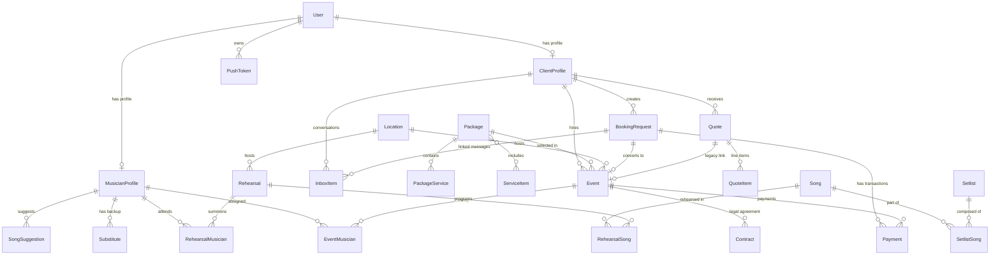

# CONTEXTO 01: ESQUEMA EXACTO DE BASE DE DATOS Y ARQUITECTURA RELACIONAL

**Sistema:** Vendetta Live Music (`vendetta.mx`)  
**Tecnología:** Next.js 16, TypeScript, Prisma v7 (`@prisma/adapter-libsql`), SQLite (`prod.db`)  
**Carácter:** Documentación Descriptiva y Exhaustiva (Sin Omisiones)

---

## 1. INVENTARIO COMPLETO DE MODELOS PRISMA

A continuación se documentan todos los modelos declarados en `prisma/schema.prisma` y verificados con las tablas físicas de la base de datos SQLite.

---

### 1.1 Modelo: `User`
* **Tabla física:** `User`
* **Propósito:** Gestión de identidades y credenciales de acceso para Administradores, Agentes, Clientes y Músicos.
* **Clave Primaria:** `id` (String UUID).
* **Campos:**
  | Campo | Tipo | Nullable / Requerido | Default | Unique | Índice | Relación / FK | onDelete | Valores Observados |
  |---|---|---|---|---|---|---|---|---|
  | `id` | String | Requerido | `uuid()` | Sí (PK) | - | - | - | UUID v4 |
  | `name` | String? | Opcional | `null` | No | - | - | - | Nombres de usuarios |
  | `email` | String? | Opcional | `null` | Sí | - | - | - | Correos normalizados |
  | `emailVerified` | DateTime? | Opcional | `null` | No | - | - | - | Timestamps |
  | `image` | String? | Opcional | `null` | No | - | - | - | URLs |
  | `password` | String? | Opcional | `null` | No | - | - | - | Hash bcrypt ($2b$10/12...) |
  | `role` | String | Requerido | `"CLIENT"` | No | - | - | - | `"ADMIN"`, `"AGENTE"`, `"CLIENT"`, `"USER"` |
  | `createdAt` | DateTime | Requerido | `now()` | No | - | - | - | Timestamp ISO |
  | `updatedAt` | DateTime | Requerido | `@updatedAt` | No | - | - | - | Timestamp ISO |
* **Relaciones Inversas:** `clientProfile` (`ClientProfile?`), `musicianProfile` (`MusicianProfile?`), `pushTokens` (`PushToken[]`).

---

### 1.2 Modelo: `ClientProfile`
* **Tabla física:** `ClientProfile`
* **Propósito:** Perfil comercial, legal y fiscal de clientes (personas físicas y morales).
* **Clave Primaria:** `id` (String UUID).
* **Campos:**
  | Campo | Tipo | Nullable / Requerido | Default | Unique | Índice | Relación / FK | onDelete | Valores Observados |
  |---|---|---|---|---|---|---|---|---|
  | `id` | String | Requerido | `uuid()` | Sí (PK) | - | - | - | UUID v4 |
  | `userId` | String | Requerido | - | Sí | - | `User.id` (FK) | `Cascade` | UUID de usuario |
  | `type` | String? | Opcional | `null` | No | - | - | - | `"social"`, `"corporate"`, `"private"` |
  | `company` | String? | Opcional | `null` | No | - | - | - | Razón social o empresa |
  | `rfc` | String? | Opcional | `null` | No | - | - | - | RFC fiscal mexicano |
  | `fiscalAddress` | String? | Opcional | `null` | No | - | - | - | Domicilio fiscal completo |
  | `legalRepName` | String? | Opcional | `null` | No | - | - | - | Nombre del representante legal |
  | `legalRepRole` | String? | Opcional | `null` | No | - | - | - | Cargo / Puesto legal |
  | `legalRepPower` | String? | Opcional | `null` | No | - | - | - | Número de instrumento notarial |
  | `notificationAddress` | String? | Opcional | `null` | No | - | - | - | Domicilio para notificaciones |
  | `billingData` | String? | Opcional | `null` | No | - | - | - | Régimen fiscal y CFDI |
  | `notes` | String? | Opcional | `null` | No | - | - | - | Notas de atención |
  | `city` | String? | Opcional | `null` | No | - | - | - | Ciudad o municipio |
  | `state` | String? | Opcional | `null` | No | - | - | - | Estado de la república |
  | `whatsapp` | String? | Opcional | `null` | No | - | - | - | Teléfono a 10 dígitos |
  | `createdAt` | DateTime | Requerido | `now()` | No | - | - | - | Timestamp ISO |
  | `updatedAt` | DateTime | Requerido | `now()` / `@updatedAt` | No | - | - | - | Timestamp ISO |
* **Relaciones:** `user` (`User`), `bookings` (`BookingRequest[]`), `events` (`Event[]`), `quotes` (`Quote[]`), `inboxItems` (`InboxItem[]`).

---

### 1.3 Modelo: `MusicianProfile`
* **Tabla física:** `MusicianProfile`
* **Propósito:** Registro y disponibilidad del elenco musical (titulares y suplentes).
* **Clave Primaria:** `id` (String UUID).
* **Campos:**
  | Campo | Tipo | Nullable / Requerido | Default | Unique | Índice | Relación / FK | onDelete | Valores Observados |
  |---|---|---|---|---|---|---|---|---|
  | `id` | String | Requerido | `uuid()` | Sí (PK) | - | - | - | UUID v4 |
  | `userId` | String | Requerido | - | Sí | - | `User.id` (FK) | `Cascade` | UUID de usuario |
  | `instrument` | String? | Opcional | `null` | No | - | - | - | `"Voz"`, `"Guitarra"`, `"Bajo"`, `"Batería"`, etc. |
  | `notes` | String? | Opcional | `null` | No | - | - | - | Observaciones |
  | `role` | String? | Opcional | `null` | No | - | - | - | Rol artístico |
  | `whatsapp` | String? | Opcional | `null` | No | - | - | - | Teléfono 10 dígitos |
  | `status` | String | Requerido | `"active"` | No | `MusicianProfile_status_idx` | - | - | `"active"`, `"inactive"` |
  | `isTitular` | Boolean | Requerido | `false` | No | - | - | - | `true`, `false` |
  | `availability` | String | Requerido | `"Disponible"` | No | - | - | - | `"Disponible"`, `"Ocupado"` |
  | `rating` | Int | Requerido | `3` | No | - | - | - | 1 a 5 |
  | `createdAt` | DateTime | Requerido | `now()` | No | - | - | - | Timestamp ISO |
  | `updatedAt` | DateTime | Requerido | `now()` / `@updatedAt` | No | - | - | - | Timestamp ISO |
* **Relaciones:** `user` (`User`), `eventMusicians` (`EventMusician[]`), `rehearsalMusicians` (`RehearsalMusician[]`), `substitutes` (`Substitute[]`), `songSuggestions` (`SongSuggestion[]`).

---

### 1.4 Modelo: `BookingRequest`
* **Tabla física:** `BookingRequest`
* **Propósito:** Entidad central de prospección comercial, cálculo de viáticos, cotizaciones y contratos firmados.
* **Clave Primaria:** `id` (String UUID).
* **Campos:**
  | Campo | Tipo | Nullable / Requerido | Default | Unique | Índice | Relación / FK | onDelete | Valores Observados |
  |---|---|---|---|---|---|---|---|---|
  | `id` | String | Requerido | `uuid()` | Sí (PK) | - | - | - | UUID v4 |
  | `shortId` | String? | Opcional | `null` | Sí | - | - | - | Folio amigable `VND-XXXX` |
  | `packageId` | String? | Opcional | `null` | No | `BookingRequest_packageId_idx` | Conceptual a `Package` | - | UUID de paquete o null |
  | `packageName` | String | Requerido | - | No | - | - | - | `"Essential"`, `"Festival Premium"`, etc. |
  | `guestCount` | Int | Requerido | `0` | No | - | - | - | 0 a 2000 |
  | `venueType` | String | Requerido | - | No | - | - | - | `"salon"`, `"jardin"`, `"hacienda"`, `"playa"`, `"casa"`, `"terraza"` |
  | `calle` | String? | Opcional | `null` | No | - | - | - | Nombre de la calle |
  | `numero` | String? | Opcional | `null` | No | - | - | - | Número exterior/interior |
  | `colonia` | String? | Opcional | `null` | No | - | - | - | Colonia o fraccionamiento |
  | `zipCode` | String? | Opcional | `null` | No | - | - | - | Código Postal (5 dígitos) |
  | `municipio` | String? | Opcional | `null` | No | - | - | - | Municipio o alcaldía |
  | `address` | String | Requerido | - | No | - | - | - | Dirección consolidada |
  | `city` | String | Requerido | - | No | - | - | - | Ciudad |
  | `state` | String | Requerido | `"México"` | No | - | - | - | Estado de la república |
  | `isOutsideZone` | Boolean | Requerido | `false` | No | - | - | - | `true`, `false` |
  | `viaticosAmount` | Float | Requerido | `0` | No | - | - | - | Costo en MXN |
  | `distanceKm` | Float? | Opcional | `null` | No | - | - | - | Kilómetros desde origen |
  | `durationSec` | Int? | Opcional | `null` | No | - | - | - | Segundos de trayecto |
  | `tollCost` | Float? | Opcional | `null` | No | - | - | - | Costo de casetas |
  | `fuelCost` | Float? | Opcional | `null` | No | - | - | - | Costo de combustible |
  | `requiresManualQuote` | Boolean | Requerido | `false` | No | - | - | - | `true`, `false` |
  | `mapsLink` | String? | Opcional | `null` | No | - | - | - | URL de Google Maps |
  | `requestedDate` | DateTime | Requerido | - | No | - | - | - | Fecha a mediodía UTC |
  | `startTime` | String | Requerido | - | No | - | - | - | `"20:00"`, `"21:00"` |
  | `endTime` | String | Requerido | - | No | - | - | - | `"22:30"`, `"23:00"` |
  | `baseAmount` | Float | Requerido | - | No | - | - | - | Total del evento en MXN |
  | `depositAmount` | Float | Requerido | - | No | - | - | - | Anticipo en MXN |
  | `paymentMethod` | String | Requerido | - | No | - | - | - | `"transfer"`, `"cash"`, `"stripe"` |
  | `paymentStatus` | String | Requerido | `"pending"` | No | - | - | - | `"pending"`, `"paid"`, `"partial"` |
  | `paymentRef` | String? | Opcional | `null` | No | - | - | - | Referencia bancaria |
  | `clientName` | String | Requerido | - | No | - | - | - | Nombre completo |
  | `clientPhone` | String | Requerido | - | No | - | - | - | WhatsApp |
  | `clientEmail` | String? | Opcional | `null` | No | - | - | - | Correo |
  | `clientUserId` | String? | Opcional | `null` | No | - | - | - | UUID de User |
  | `status` | String | Requerido | `"pending"` | No | `BookingRequest_status_idx`, `BookingRequest_status_createdAt_idx` | - | - | `"pendiente"`, `"agendado"`, `"cancelado"`, `"completado"` |
  | `adminNote` | String? | Opcional | `null` | No | - | - | - | Bitácora interna |
  | `notifiedAdmin` | Boolean | Requerido | `false` | No | - | - | - | `true`, `false` |
  | `notifiedMusicians` | Boolean | Requerido | `false` | No | - | - | - | `true`, `false` |
  | `eventId` | String? | Opcional | `null` | Sí | - | `Event.id` (FK) | - | UUID de Evento |
  | `clientId` | String? | Opcional | `null` | No | `BookingRequest_clientId_idx` | `ClientProfile.id` (FK) | - | UUID de Cliente |
  | `isPublic` | Boolean | Requerido | `false` | No | - | - | - | `true`, `false` |
  | `clientProvidesAudio` | Boolean | Requerido | `false` | No | - | - | - | `true`, `false` |
  | `source` | String | Requerido | `"web"` | No | - | - | - | `"web"`, `"manual"`, `"whatsapp"` |
  | `followUpCount` | Int | Requerido | `0` | No | - | - | - | Contador de seguimientos |
  | `bandHours` | Int? | Opcional | `0` | No | - | - | - | Horas de banda en vivo |
  | `djHours` | Int? | Opcional | `0` | No | - | - | - | Horas de DJ continuo |
  | `isDjWithTvs` | Boolean? | Opcional | `false` | No | - | - | - | `true`, `false` |
  | `hasTemplete` | Boolean? | Opcional | `false` | No | - | - | - | `true`, `false` |
  | `hasPista` | Boolean? | Opcional | `false` | No | - | - | - | `true`, `false` |
  | `hasRobot` | Boolean? | Opcional | `false` | No | - | - | - | `true`, `false` |
  | `hasPantalla` | Boolean? | Opcional | `false` | No | - | - | - | `true`, `false` |
  | `quoteVersion` | Int | Requerido | `1` | No | - | - | - | Versión del presupuesto |
  | `stripePaymentIntentId` | String? | Opcional | `null` | No | - | - | - | ID Stripe |
  | `stripeSessionId` | String? | Opcional | `null` | Sí | - | - | - | ID Sesión Checkout |
  | `adminSignature` | String? | Opcional | `null` | No | - | - | - | Firma Base64 de Vendetta |
  | `clientSignature` | String? | Opcional | `null` | No | - | - | - | Firma Base64 del Cliente |
  | `signedAt` | DateTime? | Opcional | `null` | No | - | - | - | Fecha de firma |
  | `signedIp` | String? | Opcional | `null` | No | - | - | - | IP del firmante |
  | `discountAmount` | Float? | Opcional | `0` | No | - | - | - | Descuento en MXN |
  | `originalPrice` | Float? | Opcional | `0` | No | - | - | - | Precio lista antes de descuento |
  | `invoice` | Boolean | Requerido | `false` | No | - | - | - | Requiere factura fiscal (+16% IVA) |
  | `customName` | String? | Opcional | `null` | No | - | - | - | Nombre comercial del evento |
  | `ceremonyType` | String? | Opcional | `null` | No | - | - | - | Tipo de celebración |
  | `arrivalTime` | String? | Opcional | `null` | No | - | - | - | Hora de llegada de staff |
  | `setupTime` | String? | Opcional | `null` | No | - | - | - | Hora de inicio de montaje |
  | `dressCode` | String? | Opcional | `null` | No | - | - | - | Código de vestimenta |
  | `musicianNotes` | String? | Opcional | `null` | No | - | - | - | Notas técnicas para el grupo |
  | `createdAt` | DateTime | Requerido | `now()` | No | `BookingRequest_status_createdAt_idx` | - | - | Timestamp ISO |
  | `updatedAt` | DateTime | Requerido | `now()` / `@updatedAt` | No | - | - | - | Timestamp ISO |
* **Relaciones:** `event` (`Event?`), `client` (`ClientProfile?`), `inboxItems` (`InboxItem[]`), `payments` (`Payment[]`).

---

### 1.5 Modelo: `Event`
* **Tabla física:** `Event`
* **Propósito:** Agenda formal de eventos confirmados, logística, pagos y asignación de músicos.
* **Clave Primaria:** `id` (String UUID).
* **Campos:**
  | Campo | Tipo | Nullable / Requerido | Default | Unique | Índice | Relación / FK | onDelete | Valores Observados |
  |---|---|---|---|---|---|---|---|---|
  | `id` | String | Requerido | `uuid()` | Sí (PK) | - | - | - | UUID v4 |
  | `quoteId` | String? | Opcional | `null` | Sí | - | `Quote.id` (FK) | - | UUID de Quote |
  | `clientId` | String? | Opcional | `null` | No | `Event_clientId_idx` | `ClientProfile.id` (FK) | - | UUID de Cliente |
  | `locationId` | String? | Opcional | `null` | No | `Event_locationId_idx` | `Location.id` (FK) | - | UUID de Lugar |
  | `packageId` | String? | Opcional | `null` | No | `Event_packageId_idx` | `Package.id` (FK) | - | UUID de Paquete |
  | `bandEventId` | String? | Opcional | `null` | No | `Event_bandEventId_idx` | - | - | Enlace a BandEvent |
  | `date` | DateTime | Requerido | - | No | `Event_date_idx` | - | - | Fecha de evento |
  | `startTime` | String? | Opcional | `null` | No | - | - | - | Hora de inicio |
  | `amount` | Float | Requerido | `0` | No | - | - | - | Monto total |
  | `deposit` | Float | Requerido | `0` | No | - | - | - | Anticipo pagado |
  | `balance` | Float | Requerido | `0` | No | - | - | - | Saldo restante |
  | `ivaAmount` | Float | Requerido | `0` | No | - | - | - | IVA 16% |
  | `totalIncome` | Float | Requerido | `0` | No | - | - | - | Ingreso total |
  | `depositMethod` | String? | Opcional | `null` | No | - | - | - | Método de anticipo |
  | `paymentMethod` | String? | Opcional | `null` | No | - | - | - | Método de liquidación |
  | `paymentRef` | String? | Opcional | `null` | No | - | - | - | Referencia de pago |
  | `invoice` | Boolean | Requerido | `false` | No | - | - | - | Factura fiscal |
  | `totalWithTax` | Float? | Opcional | `null` | No | - | - | - | Total con IVA |
  | `guestCount` | Int | Requerido | `0` | No | - | - | - | Invitados |
  | `ceremonyType` | String? | Opcional | `null` | No | - | - | - | Tipo de evento |
  | `dressCode` | String? | Opcional | `null` | No | - | - | - | Vestimenta |
  | `performanceStart` | String? | Opcional | `null` | No | - | - | - | Inicio del show |
  | `performanceEnd` | String? | Opcional | `null` | No | - | - | - | Fin del show |
  | `logisticalNotes` | String? | Opcional | `null` | No | - | - | - | Logística |
  | `arrivalTime` | String? | Opcional | `null` | No | - | - | - | Llegada |
  | `setupTime` | String? | Opcional | `null` | No | - | - | - | Montaje |
  | `musicianNotes` | String? | Opcional | `null` | No | - | - | - | Notas músicos |
  | `status` | String | Requerido | `"scheduled"` | No | `Event_status_idx` | - | - | `"agendado"`, `"completado"`, `"cancelado"` |
  | `googleCalendarId` | String? | Opcional | `null` | No | - | - | - | ID Evento Google Calendar |
  | `notificationSent` | Boolean | Requerido | `false` | No | - | - | - | Notificación enviada |
  | `customName` | String? | Opcional | `null` | No | - | - | - | Nombre personalizado |
  | `mapsLink` | String? | Opcional | `null` | No | - | - | - | Link Maps |
  | `venueType` | String? | Opcional | `null` | No | - | - | - | Tipo de recinto |
  | `isPublic` | Boolean | Requerido | `false` | No | - | - | - | Show público / privado |
  | `clientProvidesAudio` | Boolean | Requerido | `false` | No | - | - | - | Audio provisto por cliente |
  | `source` | String | Requerido | `"manual"` | No | - | - | - | `"manual"`, `"funnel"`, `"web"` |
  | `bitacora` | String? | Opcional | `null` | No | - | - | - | Bitácora de incidencias |
  | `audioEngineer` | String? | Opcional | `null` | No | - | - | - | Ingeniero asignado |
  | `createdAt` | DateTime | Requerido | `now()` | No | - | - | - | Timestamp ISO |
  | `updatedAt` | DateTime | Requerido | `now()` / `@updatedAt` | No | - | - | - | Timestamp ISO |
* **Relaciones:** `bookingRequest` (`BookingRequest?`), `contracts` (`Contract[]`), `package` (`Package?`), `location` (`Location?`), `client` (`ClientProfile?`), `quote` (`Quote?`), `musicians` (`EventMusician[]`), `payments` (`Payment[]`).

---

### 1.6 Modelo: `Location`
* **Tabla física:** `Location`
* **Propósito:** Catálogo de recintos, salones, hoteles y direcciones de eventos.
* **Clave Primaria:** `id` (String UUID).
* **Campos:**
  | Campo | Tipo | Nullable / Requerido | Default | Unique | Índice | Relación / FK | onDelete | Valores Observados |
  |---|---|---|---|---|---|---|---|---|
  | `id` | String | Requerido | `uuid()` | Sí (PK) | - | - | - | UUID v4 |
  | `name` | String | Requerido | - | No | - | - | - | Nombre del recinto o `Show - Cliente` |
  | `address` | String | Requerido | - | No | - | - | - | Dirección |
  | `references` | String? | Opcional | `null` | No | - | - | - | Referencias |
  | `spaceType` | String? | Opcional | `null` | No | - | - | - | Tipo de espacio |
  | `logisticsNotes` | String? | Opcional | `null` | No | - | - | - | Notas de acceso |
  | `city` | String? | Opcional | `null` | No | - | - | - | Ciudad / Municipio |
  | `state` | String? | Opcional | `null` | No | - | - | - | Estado |
  | `mapsLink` | String? | Opcional | `null` | No | - | - | - | Link Google Maps |
  | `phone` | String? | Opcional | `null` | No | - | - | - | Teléfono del recinto |
  | `active` | Boolean | Requerido | `true` | No | - | - | - | `true`, `false` |
  | `createdAt` | DateTime | Requerido | `now()` | No | - | - | - | Timestamp ISO |
  | `updatedAt` | DateTime | Requerido | `now()` / `@updatedAt` | No | - | - | - | Timestamp ISO |
* **Relaciones:** `events` (`Event[]`), `rehearsals` (`Rehearsal[]`).

---

### 1.7 Modelo: `Payment`
* **Tabla física:** `Payment`
* **Propósito:** Registro financiero individual de cada abono o liquidación.
* **Clave Primaria:** `id` (String UUID).
* **Campos:** `id`, `eventId` (FK `Event`), `bookingRequestId` (FK `BookingRequest`), `amount`, `currency` (Default `"MXN"`), `method` (`"TRANSFER"`, `"CASH"`, `"STRIPE"`), `provider`, `status` (`"pending"`, `"completed"`), `reference`, `proofUrl`, `receiptUrl`, `stripeSessionId`, `stripePaymentIntentId`, `stripeChargeId`, `stripeCustomerId`, `rawPayload`, `createdAt`, `updatedAt`.

---

### 1.8 Modelo: `Contract`
* **Tabla física:** `Contract`
* **Propósito:** Enlace formal de contrato vinculado a un `Event`.
* **Clave Primaria:** `id` (String UUID).
* **Campos:** `id`, `eventId` (FK `Event`), `url`, `status` (`"pending"`, `"signed"`), `signedAt`, `createdAt`, `updatedAt`.

---

### 1.9 Modelo: `Package`, `PackageService`, `ServiceItem`
* **Tablas físicas:** `Package`, `PackageService`, `ServiceItem`, `_PackageToService`
* **Propósito:** Catálogo de formatos musicales del show y matriz de servicios incluidos/adicionales.
* **Campos `Package`:** `id`, `name`, `baseCostPerHour`, `minDuration`, `maxDuration`, `description`, `includes`, `active`, `isCustom`, `createdAt`, `updatedAt`.
* **Campos `PackageService`:** `id`, `packageId` (FK `Package`), `name`, `description`, `setupCost`, `hourlyCost`, `active`, `createdAt`, `updatedAt`.
* **Campos `ServiceItem`:** `id`, `name`, `category`, `icon`, `description`, `order`, `active`, `createdAt`, `updatedAt`.

---

### 1.10 Modelos de Repertorio y Ensayo: `Song`, `Setlist`, `SetlistSong`, `Rehearsal`, `RehearsalSong`, `RehearsalMusician`, `EventMusician`, `Substitute`, `SongSuggestion`
* **Propósito:** Gestión operativa interna de canciones, listas de temas, ensayos y plantilla musical por fecha.

---

### 1.11 Modelo: `GlobalConfig`
* **Tabla física:** `GlobalConfig` (Registro único Singleton: `id = "vendetta_config"`)
* **Propósito:** Parámetros maestros de viáticos, APIs externas (Evolution API, Google Calendar, Stripe, MercadoPago), datos bancarios y firma administrativa.

---

### 1.12 Modelos de Mensajería: `Notification`, `InboxItem`, `PushToken`
* **Propósito:** Registro de mensajes entrantes/salientes de WhatsApp (Evolution API) y notificaciones push.

---

## 2. MODIFICACIONES EN RUNTIME Y MIGRACIONES OBSERVADAS

El archivo `src/lib/db.ts` ejecuta `ensureSchemaUpToDate()` dinámicamente al inicio del servidor, aplicando sentencias SQL directas en caso de no existir ciertas columnas:
* **En `BookingRequest`:** `distanceKm`, `durationSec`, `tollCost`, `fuelCost`, `requiresManualQuote`, `bandHours`, `djHours`, `isDjWithTvs`, `hasTemplete`, `hasPista`, `hasRobot`, `discountAmount`, `originalPrice`, `invoice`, `customName`, `ceremonyType`, `arrivalTime`, `setupTime`, `dressCode`, `musicianNotes`, `hasPantalla`, `quoteVersion`.
* **En `ClientProfile`:** `fiscalAddress`, `legalRepName`, `legalRepRole`, `legalRepPower`, `notificationAddress`, `billingData`.
* **En `Event`:** `bitacora`, `audioEngineer`, `customName`, `mapsLink`, `venueType`, `isPublic`, `clientProvidesAudio`, `source`.
* **En `GlobalConfig`:** `googleMapsApiKey`, `viaticosLocalRadius`, `viaticosVehicleCount`, `msgTodayReminderActive`, `msgTemplateTodayReminder`.

---

## 3. DIAGRAMA ENTIDAD-RELACIÓN COMPLETO (MERMAID)

